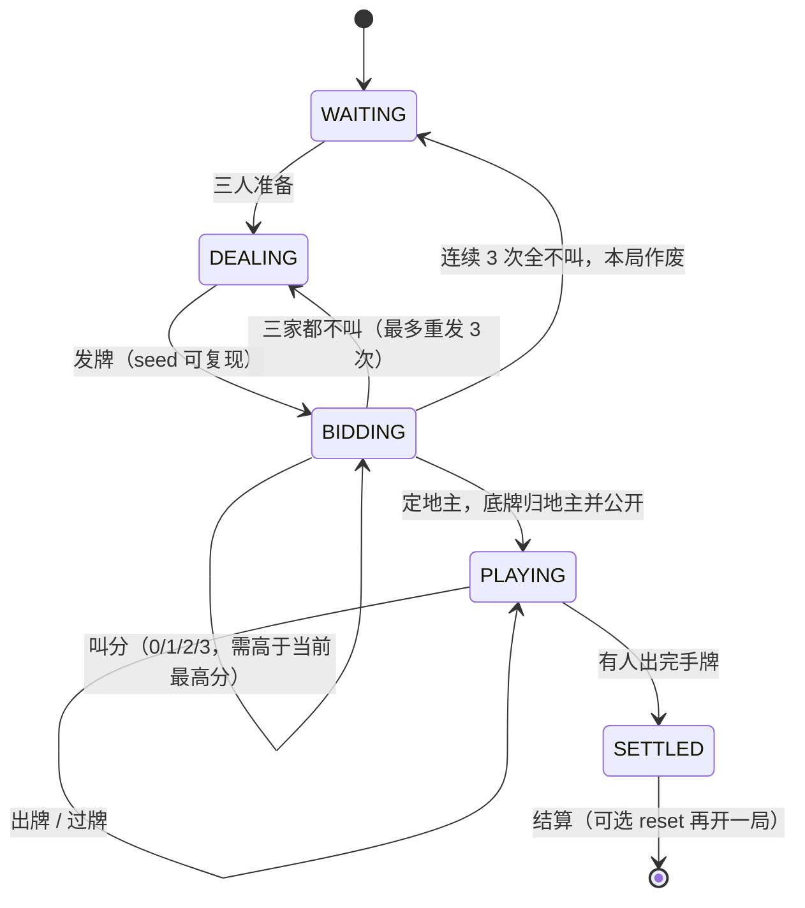

# 对局状态机说明

实现：`game/engine.py`（本项目自研） · 规则判定：`game/rules.py`（移植上游，见 `docs/参考项目与许可.md`）

## 一、状态图

## 二、参数（默认值）

| 参数 | 默认 | 说明 |
| --- | ---: | --- |
| `seat_count` | 3 | 三人一桌 |
| `bid_timeout_ms` | 10000 | 叫分超时视为不叫 |
| `play_timeout_ms` | 20000 | 出牌超时：跟牌视为过牌，先手自动出最小单张 |
| `max_redeal` | 3 | 连续全不叫的次数上限 |
| `base_score` | 1 | 底分 |
| `request_cache_size` | 256 | 每局缓存的 request_id 数量（幂等） |

计分：`总分 = 底分 × 倍数`；倍数初始为叫分，每出现一次炸弹/王炸 ×2，春天（地主赢且农民一张未出）×2。
地主胜 `+2×总分`、两个农民各 `-总分`；地主负则相反。全程整数运算。

## 三、事件（网络层的广播/观战/日志都从这里生成）

| 事件 | 触发时机 | 关键字段 |
| --- | --- | --- |
| `ready` | 玩家准备 | player、ready |
| `dealt` | 发牌完成 | deal_round、hand_counts |
| `bid_start` | 进入叫分 | first、order |
| `bid` | 有人叫分 | player、score |
| `redeal` | 三家都不叫 | reason |
| `match_aborted` | 连续全不叫达上限 | reason |
| `landlord_decided` | 定地主 | landlord、bid、bottom、hand_counts |
| `play` | 有人出牌 | player、cards、cards_text、hand_count、bomb、multiplier |
| `pass` | 有人过牌 | player、passes |
| `table_cleared` | 两度过牌，一轮结束 | leader |
| `timeout` | 超时替玩家动作 | player、phase、action |
| `game_over` | 结算 | winner、landlord_win、spring、bombs、multiplier、scores |

每个事件都带 `ts_ms`（服务端时钟）与 `state`。

## 四、视图与隐私

- `view_for(玩家)`：包含**该玩家自己的手牌**、各家张数、公开信息（地主、底牌、桌面牌、当前轮到谁、倍数、截止时间）。
- `public_view()`：观战视图，**不含任何手牌字段**，只有张数与公开信息。
- 手牌只从 `view_for` 出，网络层不得自行拼装。

## 五、幂等

`bid` / `play` / `pass_turn` 都接受 `request_id`。同一局内重复提交相同 `request_id` 时，
直接返回上一次的结果（`Action.duplicate = True`），不会重复产生副作用；缓存按 LRU 上限 256 条。

## 六、超时由外部驱动

状态机自身不启动定时器，只暴露 `deadline_ms`，由服务端定时调用 `tick()`：
到点后按规则替当前玩家动作（叫分超时=不叫、跟牌超时=过牌、先手超时=自动出最小单张）。
时钟由调用方注入（默认 `time.monotonic`），保证"一切以服务端时间为准"，测试可注入假时钟。

## 七、已知限制

1. 托管/机器人策略为 v1 简化版：先手出最小单张，跟牌选"张数最少且不动炸弹"的组合；
   不会主动拆牌组合（如凑顺子、三带一），因此一局动作数偏多（实测 60~80 步）。
2. 暂不实现反春天、明牌、加倍等扩展规则。
3. 一局结束不自动开下一局，由网络层决定是否 `reset()`。
